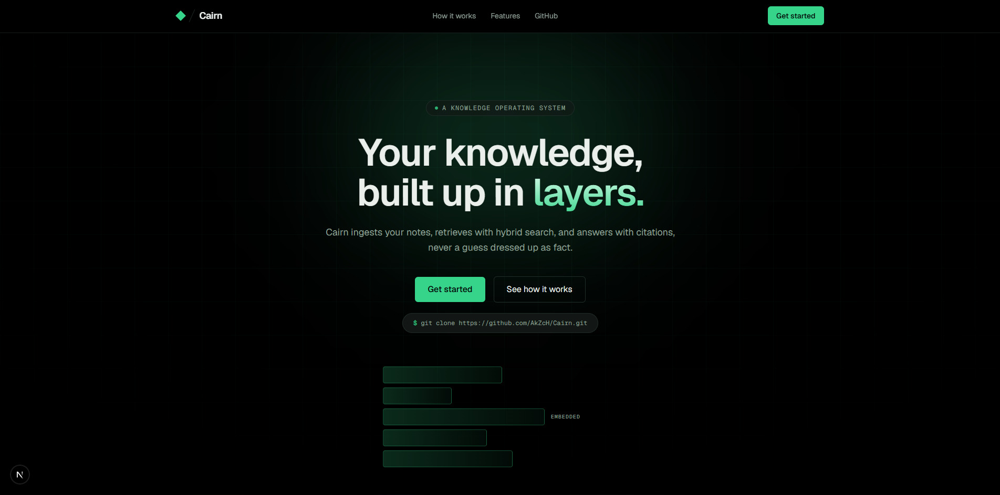

# Cairn


**A local-first, ever-evolving personal knowledge base. Ingest your notes, retrieve with hybrid search, get answers grounded in citations, not guesses.**



## Table of Contents

- [What it is](#what-it-is)
- [Key Features](#key-features)
- [Retrieval Quality](#retrieval-quality)
- [Architecture](#architecture)
- [Tech Stack](#tech-stack)
- [Quickstart](#quickstart)
- [API Reference](#api-reference)
- [Project Structure](#project-structure)
- [Development](#development)
- [Known Limitations & Roadmap](#known-limitations--roadmap)
- [License](#license)

## What it is

Cairn ingests Markdown and plaintext notes, chunks them by structure rather than arbitrary character windows, embeds them locally with no GPU required, and answers questions using hybrid retrieval, full-text search fused with vector similarity, so it catches both exact terms and related concepts your notes never used the same words for.

Every answer is grounded in retrieved passages with inline citations. If the notes don't cover something, Cairn says so instead of guessing.

## Key Features

**Retrieval**

- Structure-aware chunking: splits on headings, not fixed windows, so retrieved context stays coherent
- Hybrid search: PostgreSQL full-text + pgvector cosine similarity, fused using Reciprocal Rank Fusion
- Local embeddings: `BAAI/bge-small-en-v1.5`, run via `candle` in Rust, CPU-only, no cloud ML calls

**Ingestion**

- Two paths: a Rust CLI for whole-folder, locally embedded ingestion, and a web upload path with server-side embedding via `fastembed`, using the same model and vector space
- Edits update, not duplicate: re-ingesting a changed file replaces its old chunks rather than forking your knowledge base
- Path-based document identity with content-hash change detection

**Product**

- Multi-tenant: real accounts, JWT auth for the web app, API keys for the CLI, with data isolation verified using two separate real accounts
- Citation-grounded, multi-turn chat: conversations persist in PostgreSQL indefinitely, with a bounded context window sent per LLM call
- Citations show only the passages the answer actually references, so a "not covered" answer carries none. Upstream LLM rate limits are retried, then returned as a clean `429`
- Next.js landing page and authenticated dashboard

## Retrieval Quality

Rather than claim hybrid retrieval works, it's measured. A [reproducible evaluation harness](backend/eval/) compares four retrieval strategies against a labeled question set, mean ± standard deviation over 5 runs:

| Mode                  | Recall@5        | MRR             |
| --------------------- | --------------- | --------------- |
| Full-text (AND)       | 0.00 ± 0.00     | 0.00 ± 0.00     |
| Full-text (websearch) | 0.00 ± 0.00     | 0.00 ± 0.00     |
| Vector-only           | 1.00 ± 0.00     | 0.90 ± 0.00     |
| **Hybrid**            | **1.00 ± 0.00** | **0.90 ± 0.00** |

Both full-text modes score zero because PostgreSQL's `plainto_tsquery` and `websearch_to_tsquery` AND every query term together by default, and natural-language questions rarely share every word with the passage that answers them.

Vector search closes that gap by matching on meaning, not tokens. Hybrid retrieval degrades gracefully to whichever signal actually has useful data.

This number is real, not aspirational: building the harness surfaced and fixed two genuine bugs, a Markdown parser silently collapsing bullet lists into diluted, unfocused chunks, and a missing `ORDER BY` tiebreaker causing non-deterministic results near the retrieval limit.

These numbers come from the full `dataset.json`, labeled against the author's personal notes, so they can't be reproduced from a clean checkout. The reproducible check is the CI dataset, containing only the README and PRD, evaluated over 3 runs:

**Hybrid Recall@5: 1.00**  
**Hybrid MRR: 1.00**

That corpus is small and its ground truth is document-level, so treat it as a regression gate, not a quality claim.

Full methodology, dataset, and findings are documented in [`backend/eval/README.md`](backend/eval/README.md).

## Architecture

```text
┌─────────────┐     ┌──────────────┐     ┌─────────────────┐     ┌──────────────┐
│   ingest/   │────▶│   backend/   │◀───▶│       db/       │     │  frontend/   │
│ Rust binary │     │   FastAPI    │     │ PostgreSQL +    │     │   Next.js    │
│ parse+chunk │     │ auth, search,│     │    pgvector     │     │ landing page │
│ +embed,     │     │ chat (Groq)  │     │                 │     │ + dashboard  │
│ HTTP upload │     │              │     │                 │     │              │
└─────────────┘     └──────────────┘     └─────────────────┘     └──────────────┘
                           │
                           ▼
                    ┌──────────────┐
                    │    infra/    │
                    │ Prometheus + │
                    │   Grafana    │
                    └──────────────┘
```

- **`ingest/`**: Rust CLI. Parses Markdown/plaintext, chunks by section, embeds locally via `candle`, and uploads to the backend over an authenticated API, not a direct database connection.
- **`backend/`**: FastAPI service. Auth, hybrid retrieval, citation-grounded chat, conversation history, and document upload/intake.
- **`db/`**: SQL migrations for the full schema, plus a small dependency-free migration runner.
- **`frontend/`**: Next.js landing page and authenticated dashboard.
- **`backend/eval/`**: Reproducible retrieval evaluation harness.
- **`infra/`**: Docker Compose wiring PostgreSQL, the backend, Prometheus and Grafana.

## Tech Stack

| Layer                       | Choice                                                   |
| --------------------------- | -------------------------------------------------------- |
| Ingestion & embedding       | Rust, `candle`, `pulldown-cmark`, `reqwest`              |
| Storage                     | PostgreSQL 16 + pgvector (HNSW index, cosine similarity) |
| API & auth                  | Python, FastAPI, `asyncpg`, JWT + API keys               |
| LLM                         | Groq (`openai/gpt-oss-20b`)                              |
| Query/web-upload embeddings | `fastembed` (ONNX, same model as the Rust path)          |
| Frontend                    | Next.js, Tailwind, TypeScript                            |
| Observability               | Prometheus, Grafana                                      |

## Quickstart

```bash
cp infra/.env.example infra/.env
# Fill in GROQ_API_KEY (console.groq.com) and a real JWT_SECRET (openssl rand -hex 32)

cd infra
docker compose up --build -d
docker compose exec backend python db/run_migrations.py
```

Sign up for an account:

```bash
curl -X POST http://localhost:8000/auth/signup \
  -H "Content-Type: application/json" \
  -d '{"email": "you@example.com", "password": "a-real-password"}'
```

Save the returned `api_key` into `ingest/.env` as described in `ingest/.env.example`.

Download `BAAI/bge-small-en-v1.5` (`config.json`, `tokenizer.json`, `model.safetensors`) from Hugging Face into the per-user data directory the CLI checks:

```text
%APPDATA%\cairn\models\bge-small-en-v1.5
```

on Windows.

If the files are missing, the CLI prints the exact path it expects.

Then ingest a folder:

```bash
cd ingest
cargo run -- /path/to/your/notes
```

Run the frontend:

```bash
cd frontend
npm install
npm run dev
```

## API Reference

All routes except `/auth/*` and `/health` require:

```text
Authorization: Bearer <token>
```

JWTs are used for browser/dashboard access, while API keys are used by the CLI.

| Method | Path                           | Purpose                                                        |
| ------ | ------------------------------ | -------------------------------------------------------------- |
| `POST` | `/auth/signup`                 | Create an account, returns a JWT and a one-time API key        |
| `POST` | `/auth/login`                  | Returns a JWT                                                  |
| `GET`  | `/search?q=...`                | Hybrid retrieval, returns ranked chunks                        |
| `POST` | `/chat`                        | Citation-grounded answer, creates or continues a conversation  |
| `GET`  | `/conversations`               | List a user's conversations                                    |
| `GET`  | `/conversations/{id}/messages` | Full message history for one conversation                      |
| `POST` | `/upload/text`                 | Paste-and-ingest raw text with server-side embedding           |
| `POST` | `/upload/file`                 | Drag-and-drop `.md`/`.txt` upload with server-side embedding   |
| `POST` | `/documents/upload`            | CLI intake for pre-chunked, pre-embedded content, API key only |

Example:

```bash
curl -X POST http://localhost:8000/chat \
  -H "Authorization: Bearer $TOKEN" \
  -H "Content-Type: application/json" \
  -d '{"question": "What does my PRD say about the vector store?"}'
```

## Project Structure

```text
Cairn/
├── ingest/           # Rust CLI: parse, chunk, embed, upload
├── backend/          # FastAPI: auth, retrieval, chat, upload
├── db/               # SQL migrations + migration runner
├── frontend/         # Next.js landing page + dashboard
└── infra/            # Docker Compose: PostgreSQL, backend, Prometheus, Grafana
```

The retrieval evaluation harness lives under `backend/eval/`.

## Development

Run the retrieval evaluation harness:

```bash
docker compose exec backend python -m eval.run_eval --email you@example.com --runs 5
```

Rust tests: the Markdown parser has a regression test for tight-list chunking (`ingest/src/parser.rs`); the chunker has none yet. Run with:

```bash
cd ingest
cargo test
```

CI runs the evaluation against the checked-in corpus containing the README and PRD:

```bash
python -m eval.seed_ci
python -m eval.run_eval --email ci-eval@cairn.local --dataset dataset_ci.json --runs 3 --min-recall 0.9
```

Add a schema change as a new numbered file in `db/migrations/`, then run:

```bash
python db/run_migrations.py
```

inside the backend container. Migrations are tracked and idempotent.

## Known Limitations & Roadmap

- CI runs the retrieval eval on every push, but only against the README and PRD (`dataset_ci.json`). The full dataset depends on personal notes and can't be reproduced from a clean checkout
- Rust test coverage is thin: one regression test for the Markdown parser, none for the chunker
- Document identity is the canonical absolute path, so moving a notes folder re-ingests it as new documents and leaves the old ones behind
- Web-upload chunking (Python) is simpler than the Rust CLI's structure-aware chunker, paragraph-based and not yet feature-parity
- No password reset, email verification, or per-user rate limiting on LLM calls
- No hosted deployment, local Docker Compose only
- Single-region, single-instance PostgreSQL, no read replicas, no backup automation

## License

[MIT](LICENSE)
